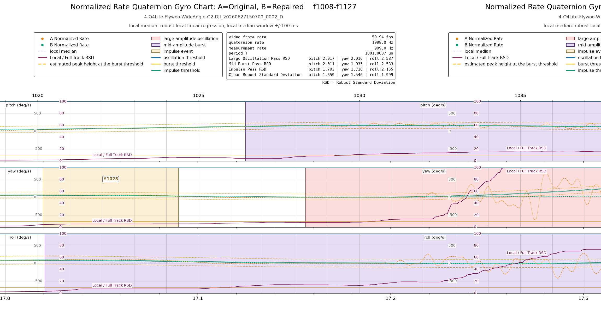

# How Gyro Doctor detects and repairs gyro noise events

Gyro Doctor repairs the gyro data track of a DJI O4 video and saves the
repaired video alongside the original. This section describes the three kinds
of gyro noise events Gyro Doctor detects, what each centerline
impacts for the repair, and what the do not repair list is for. When the repaired video still
shows false motion, use this section along with the charting and render tools to
fine tune the settings.
[The command reference of `gyro-doctor`](commands/gyro-doctor.md) gives each
setting and its default.

## The gyro data track and the gyro noise event

The gyro data track is the record of the camera's orientation embedded in the
video. Gyroflow uses this data to stabilize the video. Gyroflow treats this data
as the true motion of the camera and stabilizes each video frame against that
motion.

Due to noise issues in certain O4 air units, the gyro data track of some O4
videos can contain incorrect motion data artifacts referred to here as gyro
noise events. After stabilization, a video with gyro noise exhibits false motion
that can appear as shaking or motion ticks that never occurred. 

Gyro Doctor detects and repairs these gyro noise events so that Gyroflow can
produce smooth footage from the repaired video. Gyro Doctor first converts the
gyro data track into the angular rate of the camera on each axis in degrees per
second. The angular rate is what the gyroscope originally sensed, so a gyro
noise event is easiest to see and measure in the rate. The detection and the
repair therefore both work on the rate.

## The local median, the Robust Standard Deviation, and the noise window

Every flight and every drone has different flight characteristics. Even different
axes of a drone can have very different noise profiles. Every measurement that
Gyro Doctor uses to detect gyro noise events is relative to the flight itself, so
similar detection parameters can work across drones, across flights, and even
across the axes of one drone. In order to perform this relative measurement, Gyro
Doctor measures the noise of a local segment of the video or of a single sample
against the overall noise level of the same axis rather than using a fixed
reference. 

Gyro Doctor uses a Robust Standard Deviation as a measure of the noise of a
gyro axis, a robust locally weighted linear regression to fit a smooth line
of the gyro rate, and a noise window to measure a small segment of the gyro axis
noise against the full axis noise. Gyro Doctor calls the smooth line fit the
local median, although the fit is not a statistical median. Gyro Doctor fits the
local median over a short window that slides along the gyro rate, similar to a
rolling average. The noise in the noise window is the difference between the
recorded gyro rate and the local median.

Since Gyro Doctor measures noise relative to the local median, it can detect a gyro
noise event even in the middle of fast maneuvers, and when comparing the local 
noise profile against the full track it can reject short fast motions such as a real 
flip or roll while detecting a noise trend within the local median window.

## The Thresholds
Based on the analysis of different O4 video files, the gyro noise events can
generally be categorized into two types of events, instantaneous events that
affect only one or two video frames and longer events that are periodic or
span timeframes of hundreds of milliseconds. Gyro Doctor identifies these two
types of gyro noise events either by looking at the difference of a single sample
from the local median or by comparing the noise within the noise window against
the full axis noise.

The noise detection algorithms are tuned using relative thresholds based on a
full axis Robust Standard Deviation. The `gyro-doctor` help calls the rate the
gyro signal and describes each threshold in those terms.

For a span of noise, Gyro Doctor compares the local noise in the noise window
against the Robust Standard Deviation of the axis. A gyro noise event that spans
enough of the window raises the local noise such that the ratio of the local
noise to the full axis noise becomes very high. Where the local noise reaches the
threshold times the Robust Standard Deviation, Gyro Doctor detects a gyro noise
event.

An instantaneous event such as a sharp spike in the gyro rate is too short to
raise the local noise. To identify this type of noise event, Gyro Doctor
compares the difference of every sample from the local median with the Robust
Standard Deviation. Where that difference reaches the threshold times the Robust
Standard Deviation and the spike is very short, Gyro Doctor detects a gyro
noise event.

Based on the research of this project, there are two different classifications
of non-instantaneous gyro noise events that we classify as large amplitude
oscillations and mid-amplitude bursts. The detection runs one pass for each kind
of gyro noise event on each axis, starting with the largest kind:

1. The oscillation pass detects the large amplitude oscillations.
2. The burst pass detects the mid-amplitude bursts.
3. The impulse pass detects the impulse events.

Each pass measures the Robust Standard Deviation after removal of the gyro noise
events detected in earlier passes, so that a large gyro noise event does not hide
a smaller one. Therefore changing the thresholds of a detection pass cascades
into the following passes since the Robust Standard Deviation is recalculated.

## The detections visualized on a gyro rate chart or render
Gyro Doctor names the period of time containing a gyro noise event an extent.
The peak of an extent is the point inside it where the rate stands farthest from the
local median. Each extent is given an identifier based on the axis name followed
by the video frame number of the event's peak. The extent identifier begins with `P`
for pitch, `Y` for yaw, or `R` for roll. The identifier `Y1502` indicates a yaw extent
whose peak is at video frame 1502. Both the gyro chart and the video renders show
the identifier of each extent.

### The large amplitude oscillation

A large amplitude oscillation is a periodic swing of the rate that resembles a
sine wave. These events can span from milliseconds to several seconds or longer,
and the peak to peak amplitude of the oscillations can approach 1,000 degrees per
second. This causes the local noise value to rise dramatically higher than the
full axis noise, often more than 100 times. This type of event generally holds no
real motion that can be recovered, leading to the choice of a chord or zero
centerline for the repair. The centerline choices are described further in the
repair section below.

The gyro rate chart shown below depicts a large amplitude oscillation beginning on
the yaw axis around frame 1028, shaded in red, with the ratio of the local noise to
the full axis noise drawn on the chart's right hand axis (labeled 0 to 100 from the
bottom of the strip). When this noise ratio crosses the configured threshold (100
times the full track Robust Standard Deviation), which coincides on this chart with
the top of the strip, a large amplitude oscillation is detected. This happens in
frame 1034 as the red line goes off the chart. The detection algorithm then expands
the extent to either side to a point at which the noise event signal no longer
exists AND the return to signal criteria are met in order to capture the true
beginning and ending of the event.

### The mid-amplitude burst

A mid-amplitude burst may appear similar to the large amplitude oscillation, but
often with smaller amplitudes and characteristics similar to real flight
properties. This type of burst lasts from hundreds of milliseconds to several
seconds and may hold a series of large impulse events that are triggered during
dynamic flight and run together or occur rapidly in close proximity. With an
amplitude of tens to hundreds of degrees per second, a mid-amplitude burst lies in
the range of real motion and is hard to differentiate from the motion of PID
oscillations, propwash, and even high winds. This commonly leads to a centerline
choice of the local median, which approximates the recoverable real motion during
these events.

The same gyro rate chart from above and copied below also depicts a mid-amplitude
burst on the roll axis, as the ratio of the local noise to the full axis Robust
Standard Deviation crosses the burst threshold of 10 times the Robust Standard
Deviation. The ratio crosses the burst threshold on roll in frame 1025, and once
again the algorithm widens the extent to capture the full beginning and ending of
the event.
  
*Note: the orange dashed lines on this chart also indicate a band for the estimated
gyro signal peak height at the burst threshold. While this is an estimate only, you
can see the rates moving close to or outside of that band for every mid-amplitude
burst detection. The mid-amplitude burst on the pitch axis may actually be a series
of impulse events. Tuning the burst threshold higher would possibly allow those
events to pass through to the impulse pass, permitting a more precise repair.

### The impulse event

Most gyro noise events detected by Gyro Doctor are impulse events, as large
amplitude oscillations appear to be rare and may be unit or build specific. As
described above, an impulse event is an abrupt rise or sharp spike in the gyro
rate, and these events are too short to raise the local noise measurement. The
whole event usually lasts close to 25 milliseconds, so at a 60 Hz video frame rate
these events usually span only a frame or two. In the gyro chart, which draws
every sample (roughly 1 kHz or 2 kHz), an impulse event looks like an
instantaneous large amplification of the otherwise normal gyro signal. When the
noise is represented at the video frame rate, the event appears to form a tall
acute triangle, as the frame level motion moves abruptly up then down or vice
versa. The event causes an obvious jump in the stabilized video that doesn't
appear in the original video. An impulse event is often far larger than real
motion, though some small impulse events can fall below the peaks of real motion,
making them hard to discern from real motion.

Due to the shape of impulse events and the difference between the gyro measurement
rate and the video frame rate, not every impulse event will create visible motion
in your stabilized video. How the event aligns to the video frames themselves
changes the impact on the video frames. Since Gyroflow will use the average motion
across a frame, an event that has equal positive and negative motion within a frame
cancels out. An event with positive motion all in one frame and negative motion all
in the following frame will appear to have abrupt changes in each of those frames.
Essentially, the noise at the video frame rate is the aliased noise of the gyro
rate event. This makes frame rate detection less desirable than full gyro rate
detection, since the same event can cause different results depending on where it
lines up in time. Low pass filters are also less effective since they target all
frequencies above the cutoff instead of targeting the noise events themselves.

In the gyro chart below, you can see a very large impulse event identified as P2294
with a peak of 87.5 degrees per second on an axis that has an impulse threshold of
4.5 times the Robust Standard Deviation (1.795 degrees per second) of that axis,
creating an impulse threshold range of approximately +/- 8 degrees per second. That
range is represented by the solid green lines around the gyro signal.

Since motion across an impulse event usually spans two to three frames, most real
motion can be recovered, leading to a choice of either the local median centerline
or a chord across the extent from the rate at its start to the rate at its end. The
ceiling value can be tuned to remove more or less of the event as described below.

## The repair

Gyro Doctor repairs each gyro noise event by attenuating the noise so that its
peak falls below a maximum ceiling from the centerline of its classification.
All motion outside the gyro noise events remains exactly as recorded. The
attenuation applies the same factor to every part of the extent, so at any
ceiling above 0 the repair keeps the shape, the direction, and the timing of the
gyro noise event and changes only its magnitude. A short fade at each end of the
extent blends the repaired event into the motion surrounding the extent.

The defaults of Gyro Doctor are intended to lean toward less repair. A repair that
invents motion your camera never recorded looks worse than a barely perceptible
remainder of a gyro noise event. This doesn't mean that every false positive
injects motion, or that impulse detections near the threshold are incorrect. The
repair of these events toward a local median and the small amount of rotation that
the repair removes from a near threshold impulse event help prevent the repairs
from fabricating false motion.

Do not be overly concerned if you see small impulse detections and repairs you
cannot perceive near the impulse threshold. Raising the threshold may cause
detection to miss some real near threshold events that you *can* perceive due to
the way they span video frames as described above.

### The centerline

The centerline is the curve toward which the repair attenuates a gyro noise
event. The repair keeps the motion trend that the centerline follows, attenuating
the noise around that centerline. The centerline options are:

- `local-median` as described above is a smooth line that a robust locally
  weighted linear regression fits to the gyro rate. Attenuating a noise event
  toward the local median retains some of what is likely real motion, which allows
  a repair to keep the general shape of the signal. When the centerline is set to
  `local-median` and the ceiling is set to 0, the gyro rates within an extent are
  equal to the local median. The local median is usually a good choice for a
  mid-amplitude burst and an impulse event.
- `chord`, a sloped line across the extent from the rate at its start to the rate
  at its end. When the centerline is set to `chord` and the ceiling is set to 0,
  the motion left within an extent is the sloped straight line connecting the
  signal on either side of the extent. The chord suits a gyro noise event where the
  repair needs to connect the edges of the event while real motion is happening,
  such as a large amplitude oscillation or a fast mid-amplitude burst.
- `zero`, a constant rate of 0 degrees per second across the extent. When the
  centerline is set to `zero` and the ceiling is set to 0, this option removes all
  the motion within the extent. This centerline also suits a large amplitude
  oscillation and occasionally very disruptive impulse events.

### The ceiling

The ceiling sets how much attenuation the repair applies to a gyro noise event.
Like the thresholds, the ceiling is expressed relative to the clean Robust
Standard Deviation of the axis, measured with every detected event removed. A
relative ceiling lets similar settings work across drones, flights, and axes,
whose noise levels differ.

The repair scales the whole event down until its largest departure from the
centerline is the ceiling times the clean Robust Standard Deviation, so a larger
event receives more attenuation. An event already below the ceiling is left as
recorded. A ceiling of 0 collapses the event onto the centerline.

For example, if you set the ceiling to 1 clean Robust Standard Deviation, the
largest departure from the centerline of EVERY gyro noise event above the ceiling
is attenuated to exactly 1 clean Robust Standard Deviation, no matter how large it
was before attenuation. A larger event is therefore attenuated more than a smaller
event, and both are capped at the same ceiling.

### Horizon lock on a repaired video

Stabilize the repaired video in Gyroflow with horizon lock off. Horizon lock levels
the picture by the camera's orientation relative to the earth, which each DJI
quaternion records. The repair removes rotation from those orientations, and the
removed rotation carries forward to shift the earth reference of every later
orientation. That shifted earth reference no longer matches the real horizon, so
horizon lock breaks down on a repaired video. This is a known issue related to how
Gyro Doctor removes false rotation.

## The false positives you can expect

Gyro Doctor detects gyro noise events from the gyro data track alone. As a result,
some types of real motion can trigger the detection algorithms. Additionally,
tuning the detector with a low threshold to remove all small amplitude events can
lead to real motion at that threshold being detected as if it were noise. But not
every false positive leads to visible false motion.

You can expect these types of false positives:

- A landing or an impact can cause extreme gyro noise, triggering false positives.
- Some fast maneuvers can be detected as mid-amplitude bursts, which is why the
  local median is the recommended repair centerline.
- PID oscillations, propwash, and high winds can likewise be detected as a
  mid-amplitude burst.
- A motion whose peak lies very close to the impulse threshold may appear to be an
  impulse event. However, the repair of these very small events is often
  undetectable to the human eye.

### The do not repair list

Gyro Doctor permits you to declare any extent, time range, or frame range as "real
motion" via a "do not repair" list. To prevent false positives from causing fake
motion to be added to your stabilized videos, add the identifiers of those extents
to the do not repair list. The repair then ignores the named extents and ranges. See "The do not
repair list" in [the command reference of `gyro-doctor`](commands/gyro-doctor.md)
for details on excluding events from the repair.

---

[<< back](quick-start.md) | [Return to Table of Contents](README.md) | [next >>](commands/gyro-doctor.md)

