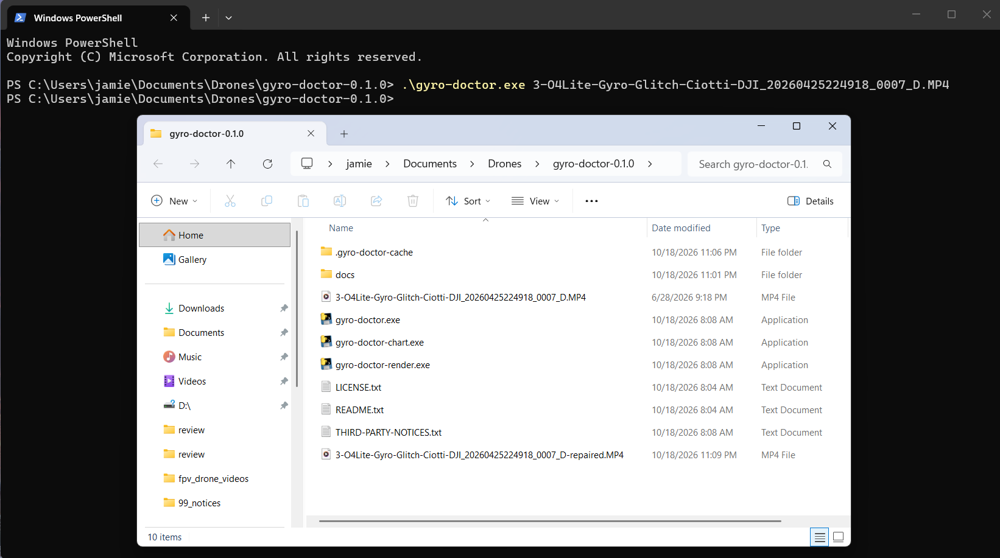
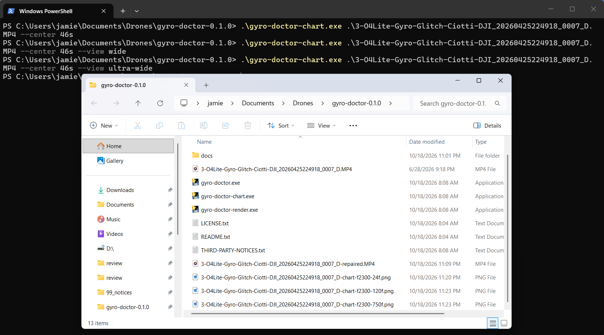
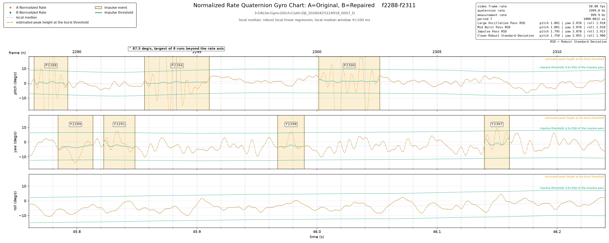
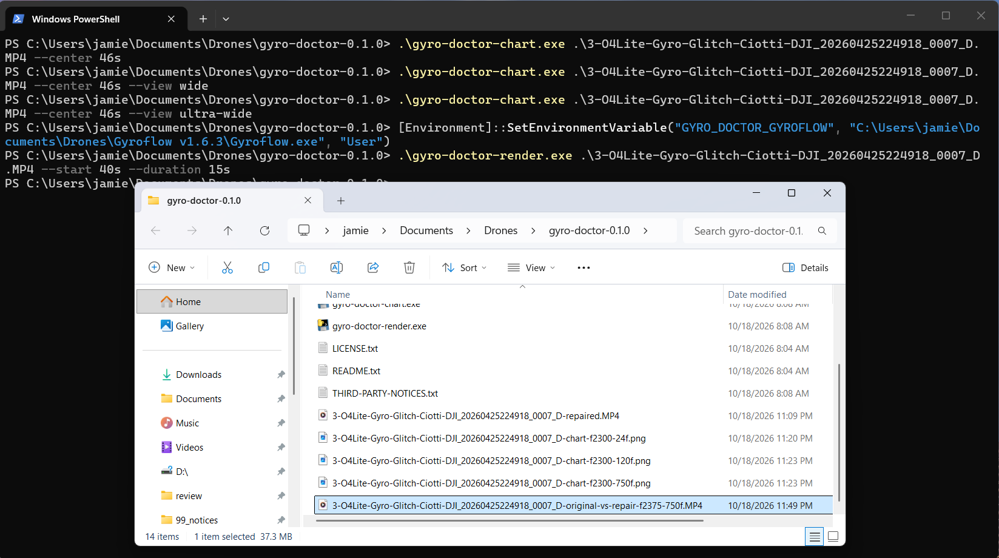
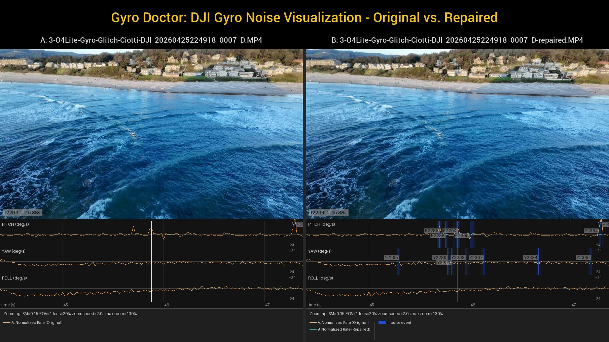

# The quick start guide

Gyro Doctor is a software utility that repairs the data track of a DJI O4
video that exhibits incorrect motion when stabilized by Gyroflow. This
guide walks you through your first repair on Windows, starting from the
unzipped folder.

## Before you begin

Gyro Doctor does not need to be "installed" on Windows or any other system.
It's a standalone command line tool that you run from your favorite
shell. This means you can either add the unzipped distribution folder to
your `PATH` or run the commands from a shell opened in that folder.

To add the unzipped folder to your `PATH`, run this command in PowerShell,
replacing the path with the location of your Gyro Doctor folder:

```
[Environment]::SetEnvironmentVariable("Path", [Environment]::GetEnvironmentVariable("Path", "User") + ";path\to\gyro-doctor-v0.1.0", "User")
```

- In PowerShell, run the program with `.\gyro-doctor.exe`.
- In Command Prompt, run it with `gyro-doctor.exe`.

The commands below assume PowerShell.

## Try Gyro Doctor from the command line

- Open the Gyro Doctor folder in File Explorer. Right-click an empty area inside
  the folder, not on a file, and select "Open in Terminal".
- Copy an O4 video file that exhibits gyro noise into the folder.
- Run the following command:

  ```
  .\gyro-doctor.exe path\to\video_file.mp4
  ```

The command prints nothing if all goes well.



*Note: This might take a minute or two, depending on the speed of your
computer. Gyro Doctor opens the video, reviews the full gyro data track, tries
to find the gyro noise events, and repairs them. It keeps a cache in the folder
where you run the command, which speeds up later runs.*

## Inspect the repair

If you already know where a noise event exists in the video, you can create a
chart of the gyro data to inspect the repair. The commands below create the
chart in the regular, wide, and ultra-wide views:

```
.\gyro-doctor-chart.exe path\to\video_file.mp4 --center 46s
.\gyro-doctor-chart.exe path\to\video_file.mp4 --center 46s --view wide
.\gyro-doctor-chart.exe path\to\video_file.mp4 --center 46s --view ultra-wide
```

*Note: The chart and render commands take the path of the **original** video,
since they compare the original and repaired gyro data. Gyro Doctor locates the
cache in the working directory based on the original video's file name.*



In the chart below, a very large gyro noise burst appears on the pitch axis in
the "A" Normalized Rate (original) series in orange, centered near frame 2294
and labeled P2294. This *impulse* event peaks at 87.5 degrees per second, where
the expected noise floor is about 10 degrees per second. Across the yellow
shaded area of this event, the "B" Normalized Rate (repaired) series in green
shows that the repair reduces most of the noise of the event to near zero while
keeping a small amount of the shape of the data.



## View the results!

Render the before and after video through Gyroflow, annotated with the noise
events on the gyro strip. This step needs the path of your Gyroflow executable
in a user environment variable, so that Gyro Doctor can call Gyroflow. In
PowerShell, run the following commands. The first two set the variable, using
that path, and the third renders the A/B video:

```
$env:GYRO_DOCTOR_GYROFLOW = "path\to\gyroflow.exe"
[Environment]::SetEnvironmentVariable("GYRO_DOCTOR_GYROFLOW", "path\to\gyroflow.exe", "User")
.\gyro-doctor-render.exe path\to\video_file.mp4 --start 40s --duration 15s
```

If `GYRO_DOCTOR_GYROFLOW` holds the path of your Gyroflow executable, the render
will begin. It may run a while, depending on the speed of your computer. When the command completes, the
composite video is in the current folder next to the original.



Open the video in VLC or your favorite video player to see the results!



## Next steps

To learn more about the advanced options of repair tuning and visualization,
read the command line help of each command:

```
.\gyro-doctor.exe --help
.\gyro-doctor-chart.exe --help
.\gyro-doctor-render.exe --help
```

---

<div align="center">

[<< back](README.md) | [Return to Table of Contents](README.md) | [next >>](detection-and-repair.md)

</div>
